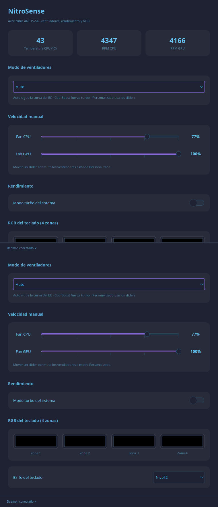

# nitro-wmi — port de NitroSense (Acer) a Linux

Control de ventiladores, modos de rendimiento y monitoreo para laptops
**Acer Nitro/Predator** — porte de la funcionalidad central de
NitroSense 3.01.3056, construido por ingeniería inversa.

Validado contra el firmware de un **Nitro AN515-54** (CachyOS, kernels 7.3.x y 6.18 LTS).



## Instalación rápida

```fish
git clone git@github.com:Gjaset/nitro-sense-linux.git
cd nitro-sense-linux
sudo ./install.sh        # compila, registra en DKMS y activa el daemon
# → reinicia ←
nitro-boot-check         # verifica módulo, DKMS, daemon, sensores y protocolo
```

`install.sh` es idempotente y deja **una sola versión** registrada en DKMS, de
modo que las actualizaciones de kernel no fallen por comparación de versiones.
El módulo se recompila solo en cada kernel instalado (clang o gcc según
`CONFIG_CC_IS_CLANG`). La GUI aparece en el menú como *NitroSense for Linux*.

## Arquitectura

```
CLI nitro ──► sysfs /sys/bus/wmi/devices/7A4DDFE7-*/nitro_wmi/
                    │
              módulo kernel nitro-wmi.ko
                    │  wmi_evaluate_method(GUID gaming, method_id, u64)
                    ▼
        Firmware ACPI: \\_SB.PCI0.WMID.WMBH (clase AcerGamingFunction)
                    │
                    ▼
              EC: CPUF/GPUF/TKST/CPOC/GPOC (MMIO 0xFC7E0800)
```

Fuentes del protocolo (todos coinciden):
1. PSSvc.exe de NitroSense (RE estático — informes 1-6 en `docs/informes/`)
2. Módulo comunitario facer.c (GUID + method IDs)
3. MOF binario del BIOS (bmof → clase AcerGamingFunction, 23 métodos)
4. AML del SSDT9 (WMBH: layout exacto del u64 y rangos validados)

La evidencia completa está en [`docs/`](docs/): informes de RE y volcados ACPI
del AN515-54 (`dsdt.dsl`, `ssdt9.dsl`, `bmof_10.mof`).

## Uso

```fish
make            # compila módulo + CLI
sudo insmod nitro_wmi.ko   # (o: sudo make load)
./nitro status
./nitro monitor          # RPM/temp en vivo
./nitro fan cpu 60       # fan CPU al 60%
./nitro fan cpu auto     # restaura tabla por defecto
./nitro turbo on
./nitro table 3           # curva Turbo
./nitro gpuoc 1
./nitro raw 14 1          # experimento: SetGamingFanBehavior (VM FOMB del EC)
cat /sys/bus/wmi/devices/7A4DDFE7-*/nitro_wmi/raw_result
```

## Atributos sysfs

| Atributo | RW | Semántica (verificada en AML) |
|---|---|---|
| fan_cpu_percentage | rw | 0-100 → WMI 16 [1, pct] → EC CPUF |
| fan_gpu_percentage | rw | 0-100 → WMI 16 [4, pct] → EC GPUF |
| fan_table | rw | 1-3 → WMI 18/19 → EC CPOC (Normal/Fast/Turbo) |
| turbo_mode | rw | 0/1 → WMI 22 índice 1 → EC TKST |
| gpu_oc_level | rw | 0-2 → WMI 22 índice 5 → EC GPOC |
| cpu_fan_rpm | ro | WMI 5 sensor 2 (C1FR), bits 8-20 |
| gpu_fan_rpm | ro | WMI 5 sensor 6 (G1FR) |
| cpu_temp | ro | WMI 5 sensor 1 (CTMP) |
| raw_call / raw_result | wo/ro | `<method> <hex_u64>` — experimentos |

## Notas de seguridad

- El firmware valida rangos (fan >100 → error 2; tabla fuera de 1-3 → error 2;
  índice misc inválido → error 3). El módulo los mapea a -EINVAL/-EIO.
- El EC conserva sus protecciones térmicas; aún así, evita 0-19% sostenidos.
- Método `raw` = poder total: solo para experimentación (methods 1-15 pasan por
  el intérprete FOMB del EC — comportamiento no auditado por AML).

## Etapa 2 — daemon del protocolo NitroSense (implementada)

`nitro-daemon` (C, ~600 líneas): servidor del protocolo de 35 comandos de PSSvc sobre
**socket UNIX** con el framing exacto de TsDotNetLib:

```
CMF petición:  [u16 cmd][u8 argc] + argc × ([u32 size][data])   (tamaños sin alinear)
RMF respuesta: [u8 retArgc] + n × ([u32 size][data])           (status u32 primero)
```

- Socket: `/run/nitro-sense/nitrosense.sock` (systemd `RuntimeDirectory`)
- Auth: `SO_PEERCRED` (uid/pid/comm registrado por conexión) + status 0x13/0x10
- **Registro emulado** en `/var/lib/nitro-sense/registry.conf` con scope forzado a
  `SOFTWARE\OEM\NitroSense` (corrige la escritura arbitraria de NitroSense, informe 2 §7)
- Pasarela WMI a `AcerGamingFunction` vía `raw_call` del módulo (methods 1,2,3,5,6,10,12,13,14,16,20,22,23)
- 0x1E (modo de operación): prueba `(mode<<8)|0x0B` (BIOS nuevas) → fallback TKST (esta BIOS)
- No soportados por diseño: spawn de procesos (0x07/0x08), NVIDIA/Intel OC (0x0E,0x15-0x1A,0x20), APGeAction (0x11/0x14)

Uso:

```fish
systemctl status nitro-sense                     # estado del daemon
nsclient /run/nitro-sense/nitrosense.sock selftest   # 13/13 esperado
nsclient /run/nitro-sense/nitrosense.sock 0D u32:0001  # temp CPU cruda
nsclient /run/nitro-sense/nitrosense.sock 0F u64:0x820009  # fans turbo (CoolBoost)
```

## Etapa 3 — RGB + GUI + tecla dedicada (implementada)

**platform_profile**: implementado en v0.4.0 y **deshabilitado en v0.4.4**
mientras se corrige el patrón de baja del registro (el cleanup devm provocó un
`device_del(NULL)` al hacer `rmmod`; ver `ACTA_VERIFICACION.md`). Vuelve en v0.5
con el patrón verificado del source del kernel. Mientras tanto, el perfil se
controla con `nitro table` + `nitro turbo`.

**RGB del teclado** (4 zonas, layouts verificados en el AML del SSDT9):
```
echo ff0000 | sudo tee .../nitro_wmi/kb_rgb_zone1   # RRGGBB por zona (bits 1/2/4/8)
cat .../nitro_wmi/kb_rgb_zone1                     # GET real del EC (method 7)
echo 3 | sudo tee .../nitro_wmi/kb_brightness      # niveles 1-4 (KBBP=(n-1)*25)
```

**GUI** (`nitro-sense-gui`, Python+GTK3, cero dependencias nuevas):
- Cliente del daemon por socket (arquitectura idéntica a la UWP→PSSvc de NitroSense)
- Monitor en vivo (temp/RPM), modo de fans (Auto/CoolBoost/Custom), sliders %,
  turbo, 4 selectores de color RGB y brillo del teclado
- Aparece en el menú de aplicaciones como "NitroSense for Linux"
- **v3**: corrige el envío de argumentos al daemon (antes `proto_call` iteraba
  un `bytes` suelto como enteros y GTK tragaba el `TypeError`: los sliders se
  movían pero ningún ajuste llegaba al EC), protege la carga inicial para no
  forzar modo Personalizado al abrir, aplica debounce de 180 ms al slider y
  rediseña la ventana (760×880, tarjetas, márgenes de 28 px, controles grandes)

## Tecla dedicada NitroSense (en investigación)

El firmware de este modelo entrega las hotkeys por el GUID de eventos
`676AA15E-6A47-4D9F-A2CC-1E6D18D14026` (`Notify(WMID, 0xBC)`), pero el EC solo
dispara las teclas de lanzamiento si el bit **LMEN** ("Launch Manager ENable",
bit 7 de `ECMM+3`, `0xFC7E0803`) está activo — algo que en Windows hace el
"Launch Manager" de Acer y que ningún driver Linux escribe. El módulo v0.4.2+
lo activa en el probe y registra un input "NitroSense key"; el parámetro
`nitro_event_code` elige qué código APGe (byte 1) emite la tecla virtual:

```fish
echo 0x8A | sudo tee /sys/module/nitro_wmi/parameters/nitro_event_code
```

Con `0` (default) solo se registran los eventos en `dmesg` para descubrimiento:

```fish
sudo dmesg --follow | grep -i "evento APGe"
```

> **Estado**: la hipótesis LMEN está implementada pero aún **no confirmada en
> hardware** para este modelo. Si al pulsar la tecla no aparece `018a01` en
> `dmesg`, el EC no está emitiendo el evento y habrá que revisar `_Q41`/ECMM.

## Verificación

```fish
nitro-boot-check      # módulo, DKMS, daemon, sensores, protocolo y GUI (sin sudo)
```

Prueba funcional de los ventiladores (el EC debe cambiar de RPM de verdad):

```fish
nitro fan cpu 77                  # CPU al 77% → modo Personalizado
cat /sys/bus/wmi/devices/7A4DDFE7-*/nitro_wmi/fan_cpu_percentage   # debe leer 77
nitro fan cpu auto                # restaura el control automático
```

## Roadmap

- [x] Etapa 1: módulo kernel + CLI (v0.4.4, DKMS persistente, 2 kernels)
- [x] Etapa 2: daemon protocolo 35 comandos + servicio systemd (selftest 13/13)
- [x] Etapa 3: RGB/brillo del teclado + GUI GTK3 (v3, espaciosa y con debounce)
- [ ] Etapa 4: tecla dedicada NitroSense (LMEN implementado, pendiente de validar)
- [ ] Etapa 5: `platform_profile` (deshabilitado en v0.4.4 tras el oops de `rmmod`)

## Licencia

GPL-2.0 — ver [`LICENSE`](LICENSE). El módulo declara `MODULE_LICENSE("GPL")`
porque usa símbolos GPL del kernel (`wmi_*`) y debe ser GPL para cargarse sin
taint.

## Documentación

- [`docs/informes/`](docs/informes/) — 6 informes de ingeniería inversa
- [`docs/acpi/`](docs/acpi/) — DSDT, SSDT9 y MOF del BIOS del AN515-54
- [`ACTA_VERIFICACION.md`](ACTA_VERIFICACION.md) — verificación en hardware,
  incidente DKMS y lecciones aprendidas

